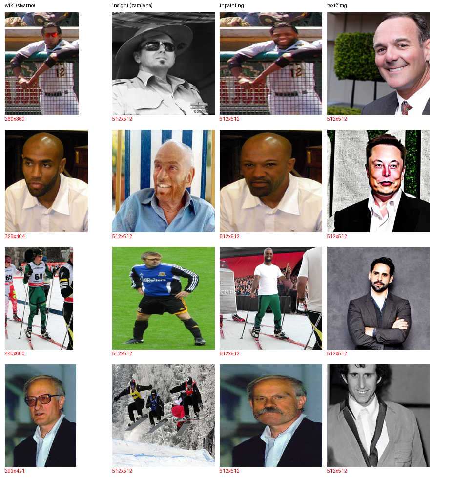

# Detekcija deepfake lica i generalizacija na nepoznate metode lažiranja

Detektor stvarnih i lažnih slika lica zasnovan na dubokom učenju, s posebnim fokusom na
pitanje koje je ključno u praksi: **prepoznaje li detektor i metode lažiranja koje tokom
treninga nije vidio?**

Projekat iz predmeta *Metode i primjena vještačke inteligencije*, ETF Sarajevo, 2026/2027.

## Sadržaj

- [Problem](#problem)
- [Istraživačka pitanja](#istraživačka-pitanja)
- [Podaci](#podaci)
- [Metodologija](#metodologija)
- [Plan](#plan)
- [Instalacija](#instalacija)
- [Upotreba](#upotreba)
- [Struktura projekta](#struktura-projekta)
- [Rezultati](#rezultati)
- [Tim](#tim)
- [Licenca](#licenca)

## Problem

Zamjene lica i lica generisana difuzionim modelima koriste se za lažne profile, prevare i
krađu identiteta. Nove metode lažiranja nastaju brže od detektora — zato mjerimo ne samo
tačnost na poznatim metodama, nego i **generalizaciju na nepoznate**.

## Istraživačka pitanja

1. Koliko dobro detektor razlikuje stvarna od lažnih lica kada su u testu iste metode
   lažiranja kao u treningu?
2. Koliko tačnosti detektor gubi na metodama lažiranja koje nije vidio tokom treninga?
3. Da li trening na više metoda lažiranja smanjuje taj gubitak?
4. Na koje dijelove slike detektor obraća pažnju — na lice ili na pozadinu i artefakte
   formata?

## Podaci

[DeepFakeFace](https://huggingface.co/datasets/OpenRL/DeepFakeFace) — 120.000 slika:

| Dio | Slika | Sadržaj |
|---|---:|---|
| `wiki` | 30.000 | stvarna lica (IMDB-WIKI) |
| `insight` | 30.000 | zamjena lica (InsightFace) |
| `inpainting` | 30.000 | Stable Diffusion Inpainting |
| `text2img` | 30.000 | Stable Diffusion 1.5 |

Podaci se **ne čuvaju u repozitoriju**. Putanja se zadaje varijablom okruženja `MPVI_DATA`.

Dva rizika koja moramo kontrolisati:

- **Curenje podataka** — `insight` i `inpainting` slike nastale su prepravljanjem stvarnih
  slika, pa podjelu radimo po izvornoj slici, ne nasumično.
- **Prečica preko formata** — ako se stvarne i lažne slike razlikuju po veličini ili
  kompresiji, model može naučiti tu razliku umjesto lažiranja; slike ujednačavamo prije
  treninga.

## Metodologija

| | |
|---|---|
| Bazni model | mala konvolucijska mreža, trenirana od nule |
| Glavni modeli | transfer learning — ResNet-18 i EfficientNet-B0 (ImageNet) |
| Glavna metrika | ROC-AUC (ne zavisi od praga odluke); uz nju F1 i tačnost |
| Glavni eksperiment | trening na jednoj metodi lažiranja, test na sve tri → matrica 3 × 3 |
| Objašnjivost | Grad-CAM |
| Otpornost | JPEG kompresija i smanjivanje slike |

## Plan

| Sedmica | Faza | Rezultat |
|:---:|---|---|
| 3 | M0 — definicija problema, podaci, plan | prijava, projektna knjiga, repozitorij |
| 4 | M1 — analiza i priprema podataka | statistike, podjela bez curenja |
| 5 | M2 — bazni model i transfer learning | prvi rezultati, ROC kriva |
| 6 | M3 — unakrsna generalizacija | matrica 3 × 3 |
| 7 | M4 — poboljšanje generalizacije | poređenje jedne i dvije metode u treningu |
| 8 | M5 — objašnjivost i otpornost | Grad-CAM, test kompresije |
| 9 | M6 — demo aplikacija | radni demo |
| 10 | M7 — rezerva / dodatni test | — |
| 11 | M8 — izvještaj i prezentacija | izvještaj |

## Instalacija

```bash
git clone <url-repozitorija>
cd <repozitorij>
pip install -r requirements.txt
```

Potreban je Python 3.10+ i PyTorch. Grafička kartica je preporučena, ali nije obavezna.

## Upotreba

```bash
# gdje su podaci
export MPVI_DATA=/putanja/do/podataka

# 1. preuzeti cetiri zipa s Hugging Facea u $MPVI_DATA/deepfakeface/
#    (wiki.zip, insight.zip, inpainting.zip, text2img.zip — ukupno 5,06 GB)

# 2. analiza podataka
python -m src.analiza_m1

# 3. priprema: ujednacavanje slika, podjela bez curenja, indeks
python -m src.priprema
```

## Struktura projekta

```
README.md
requirements.txt
src/
  config.py        putanje, uredjaj, sjeme
  analiza_m1.py    analiza skupa: format, crno-bijele, perceptualni hes
  priprema.py      ujednacavanje, podjela po osobi, uklanjanje curenja
results/           grafovi, tabele i metrike
```

## Rezultati

### Priprema podataka — tri skrivene prečice

Prije bilo kakvog treniranja provjerili smo po čemu se stvarne i lažne slike razlikuju osim
samog lažiranja. Našli smo tri prečice koje bi model mogao naučiti umjesto lažiranja:

| Problem | Šta smo uradili |
|---|---|
| Lažne slike su sve 512 × 512, stvarne nisu (94 % nekvadratnih) | stvarne razvučene istim putem kao lažne, sve smanjene na 256 × 256 |
| Inpainting slike su razvučene, bez čuvanja proporcija | isti postupak primijenjen na stvarne |
| 75 % insight slika (22.445 od 30.000) koristi stvarnu fotografiju **druge** osobe iz skupa kao pozadinu (perceptualni heš; kontrola text2img: 0 %) | podjela 70/15/15 po osobi; izbačeno 10.399 insight slika čija je pozadina u drugom skupu |

Hipoteza da su crno-bijele slike prečica je provjerena i **odbačena** — ima ih podjednako u
svim dijelovima (13,6–16,6 %).



Podjela poslije uklanjanja curenja (`results/m1_priprema.json`):

| Skup | wiki | insight | inpainting | text2img |
|---|---:|---:|---:|---:|
| trening | 21.000 | 16.301 | 21.000 | 21.000 |
| validacija | 4.500 | 1.634 | 4.500 | 4.500 |
| test | 4.500 | 1.666 | 4.500 | 4.500 |

## Tim

| Član | Odgovornost |
|---|---|
| | Podaci |
| | Modeli |
| | Generalizacija i otpornost |
| | Objašnjivost i prezentacija |

## Licenca

Kod: MIT. Skup podataka DeepFakeFace ima vlastitu licencu — vidi stranicu skupa.
